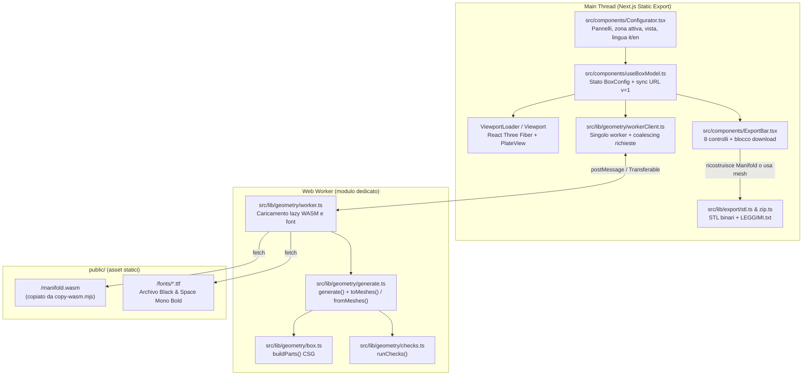

# 🏗️ Architettura di Sistema

KuboDeck separa nettamente l'**interfaccia utente** dal **motore geometrico puro**: la UI non calcola mai geometria né tolleranze, ma invia una `BoxConfig` al Web Worker e mostra le mesh e i risultati restituiti.

## Diagramma dei componenti

## Layer e responsabilità

| Modulo | Responsabilità |
| :--- | :--- |
| `src/components/Configurator.tsx` | Layout tavola CMF, 4 campioni filamento numerati, switch lingua (`it`/`en`), switch vista (`assembled`/`plate`). |
| `src/lib/geometry/workerClient.ts` | Gestisce il ciclo di vita del Worker, scarta le richieste intermedie (`Superseded`) e serializza l'esecuzione. |
| `src/lib/geometry/worker.ts` | Carica `/manifold.wasm` e i font TTF una sola volta, esegue `generate()`, converte in `PartMesh[]` e trasferisce i buffer. |
| `src/lib/geometry/generate.ts` | Funzione pura `generate(wasm, fonts, config)`: orchestra `composeArt`, `buildParts`, `runChecks`, `estimateWeightG` e misura i tempi con `performance.measure('kubodeck:generate')`. |
| `src/lib/geometry/box.ts` | Costruisce i solidi CSG `body`, `collar`, `cap`, `frontArt`, `capArt` e gestisce la deallocazione WASM (`withTemp`, `disposeParts`). |
| `src/lib/geometry/checks.ts` | Esegue i controlli geometrici e dimensionali sui `Part[]` prodotti prima di abilitare l'export. |
| `src/lib/export/stl.ts` | Converte un `Manifold` in STL binario (header `KuboDeck STL`, `triCount`, normali calcolate per triangolo). |
| `src/lib/export/zip.ts` | Impacchetta gli STL nominati per oggetto + `LEGGIMI.txt` bilingue con `fflate.zipSync`. |

## Sistema di coordinate e parti

Le unità della geometria sono direttamente millimetri (`1 = 1 mm`):

- **X**: larghezza della scatola (`78 mm` per *Standard 60*);
- **Y**: profondità (`depthMm(stackThicknessMm)`), con la faccia frontale posizionata a `y = 0`;
- **Z**: altezza verso l'alto (`104 mm` totali da montata).

Le parti generate appartengono a **due oggetti stampabili separati** (`object: 'body' | 'cap'`) e **quattro zone colore** (`body`, `cap`, `accent`, `text`):

| `PartId` | `object` | `zone` | File nello zip | Note di stampa |
| :--- | :--- | :--- | :--- | :--- |
| `body` | `body` | `body` | `kubodeck-body.stl` | Stampato in piedi con apertura in alto |
| `collar` | `body` | `accent` | `kubodeck-body-collar.stl` | Colletto interno con smusso d'invito a 45° e tacca frontale |
| `frontArt` | `body` | `text` | `kubodeck-body-front-art.stl` | Rilievo frontale verso `-Y` (opzionale) |
| `cap` | `cap` | `cap` | `kubodeck-cap.stl` | Capovolto (`z = 0` = faccia superiore) per stampa senza supporti |
| `capArt` | `cap` | `text` | `kubodeck-cap-art.stl` | Intarsio a filo sul primo layer (opzionale) |

!!! info "Origine condivisa per Bambu Studio"
    Tutte le parti di uno stesso `object` condividono la stessa origine nello spazio STL. Importandole insieme in Bambu Studio come *oggetto singolo con più parti*, restano allineate senza posizionamento manuale e permettono di assegnare uno slot AMS per ciascuna `zone`.
