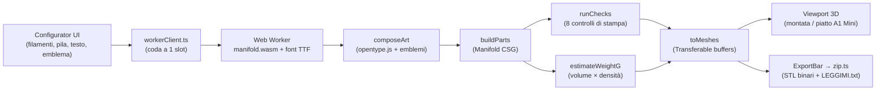

# 🚀 Executive Summary

**KuboDeck** è un configuratore web di deck box stampabili in 3D per **Bambu Lab A1 Mini** (piatto `180 × 180 × 180 mm`, ugello `0,4 mm`, AMS lite), dimensionato per **60 carte con doppia bustina** (`67 × 93 mm`).

Live app: [kubodeck.netlify.app](https://kubodeck.netlify.app) · Repository: [github.com/xdelmo/kubodeck](https://github.com/xdelmo/kubodeck)

## Il problema

Un configuratore 3D classico mostra spesso una mesh visiva semplificata che differisce dai file esportati o non verifica i vincoli reali della stampa FDM:

- superfici non chiuse (*non-manifold*) o facce coplanari nei tagli booleani;
- tolleranze del coperchio assenti o troppo strette;
- rilievi o intarsi troppo sottili per l'ugello da `0,4 mm` o fuori dalla faccia;
- zone colore sovrapposte nello stesso oggetto multi-parte per AMS.

## La soluzione

KuboDeck calcola direttamente **nel browser** una geometria CSG *manifold* reale e usa **la stessa mesh** sia per la viewport 3D sia per l'esportazione STL:

- **4 zone colore** (corpo, coperchio, accento, testo ed emblema) su 11 filamenti Bambu Lab (`PLA Basic` e `PLA Matte`) con codici e densità reali;
- **Spessore pila regolabile** (`20–40 mm`), testo (`Archivo Black` o `Space Mono Bold`) ed emblema sul fronte in rilievo o sul coperchio a filo (intarsio sul primo layer);
- **8 controlli di stampa automatici** sempre visibili: l'export `.zip` resta bloccato finché tutti i controlli non risultano verdi;
- **Configurazione condivisibile** nell'URL (`v=1`) e stima del peso dal volume reale delle mesh.

## Flusso tipico

## Stack tecnologico

| Livello | Tecnologia | Ruolo nel progetto |
| :--- | :--- | :--- |
| **Framework** | Next.js 16 App Router | Export statico (`output: 'export'`), nessun backend |
| **Linguaggio** | TypeScript (`strict`) + React 19 | Tipizzazione end-to-end e stato UI |
| **Stile** | CSS puro + CSS Modules | Token della tavola CMF in `src/app/tokens.css` |
| **Geometria CSG** | `manifold-3d` (WASM) | Generazione solidi chiusi e booleane in Web Worker |
| **Testo vettoriale** | `opentype.js` | Conversione glifi TTF in poligoni estrudibili |
| **Viewport 3D** | React Three Fiber + Three.js | Rendering interattivo vista montata e piatto A1 Mini |
| **Export** | `fflate` + serializzatore STL binario | Archivio `.zip` client-side con `LEGGIMI.txt` |
| **Test** | Vitest + Testing Library | Suite su geometria, controlli, export e UI |
| **Hosting** | Netlify | Deploy statico della cartella `out/` |
